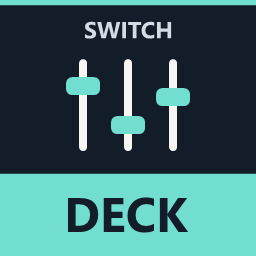
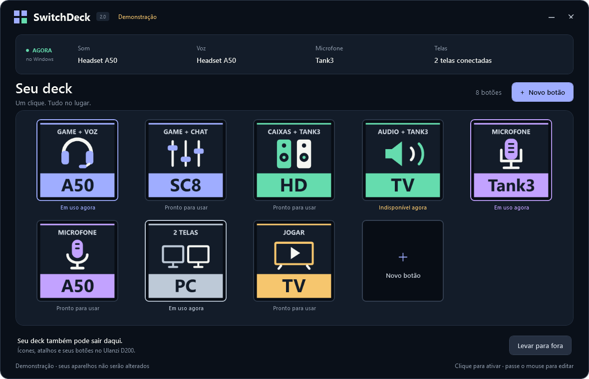
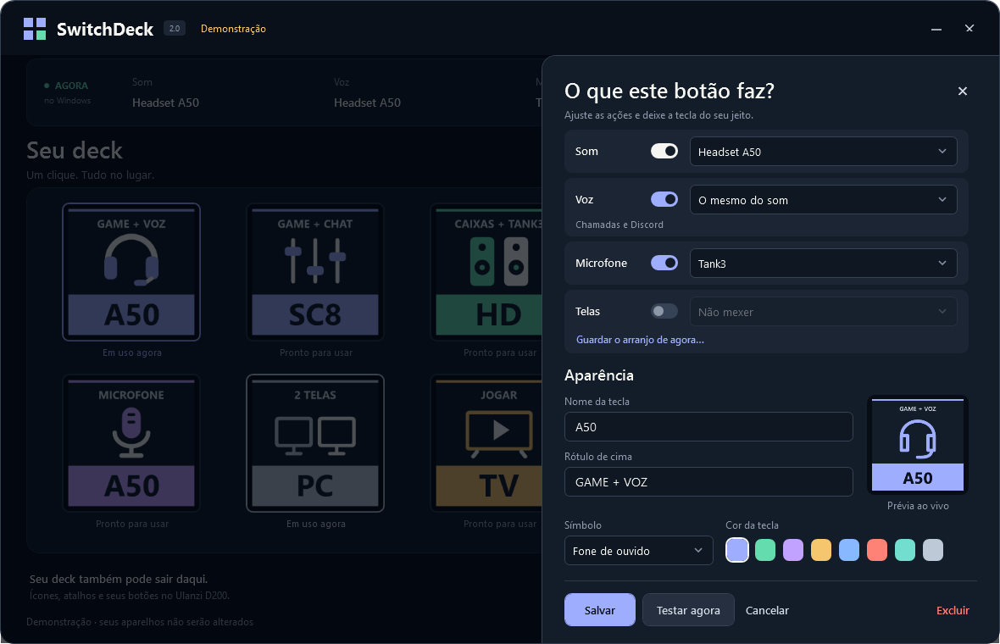
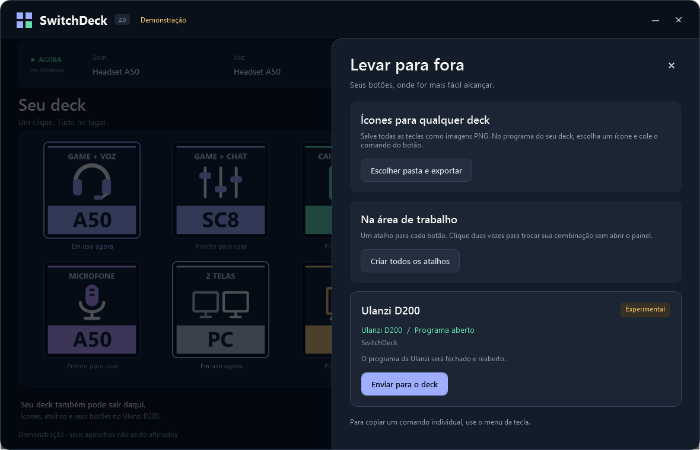

<div align="center">



# SwitchDeck

**Som, voz, microfone e telas em um clique. Monte seus botões num painel e leve para a área de trabalho ou para o seu Stream Deck.**

*One button switches audio output, voice device, microphone and monitor layout. Build your buttons in a panel and take them to the desktop or to your Stream Deck.*


</div>

---



## O que faz

Trocar de headset para caixas de som, do microfone do headset para o de mesa, ou do monitor para a TV costuma ser uma sequência de cliques nas configurações do Windows. O SwitchDeck transforma cada combinação num **botão**.

Um botão pode fazer, de uma vez, qualquer mistura de:

- **Som**: o aparelho de saída padrão.
- **Voz**: o aparelho usado em chamadas e no Discord. Pode ser o mesmo do som ou outro (por exemplo, o canal de chat de um mixer).
- **Microfone**: o microfone padrão.
- **Telas**: um arranjo de monitores guardado (quais estão ligados, qual é o principal, posição e resolução).

Cada botão ganha uma **tecla** desenhada automaticamente, com nome, símbolo e cor. O painel mostra o que está em uso agora no Windows e destaca a tecla correspondente.

## Requisitos

- **Windows 10 ou 11**
- Nada para instalar: usa apenas o **Windows PowerShell** e o **.NET Framework** que já vêm no Windows.

## Instalação

1. Baixe o projeto (**Code → Download ZIP**) e **extraia** numa pasta com permissão de escrita e, de preferência, sem espaços no caminho (ex.: `C:\SwitchDeck`).
2. Dê dois cliques em **`Instalar.cmd`**. Ele desbloqueia os arquivos, compila os componentes nativos e cria um atalho **SwitchDeck** na Área de Trabalho.
3. Abra o app pelo atalho **SwitchDeck**.

> Na primeira execução o Windows pode pedir confirmação (SmartScreen) por ser um app novo. O código é aberto e está todo nesta página.

## Como usar

### Criar um botão

Clique em **Novo botão**. No painel que abre, ligue só o que o botão deve mudar e escolha o aparelho em cada linha. O nome, o rótulo, o símbolo e a cor são sugeridos sozinhos e a prévia da tecla muda na hora; ajuste se quiser. **Testar agora** aplica sem salvar.



Para guardar um arranjo de telas, arrume os monitores nas *Configurações do Windows* do jeito que você quer e clique em **Guardar o arranjo de agora**.

No primeiro uso, **Criar um botão para cada aparelho de som** monta o básico em um clique.

### Usar

Clique na tecla. Um aviso mostra o que foi trocado. Se um aparelho estiver desligado, o SwitchDeck avisa qual é e troca o resto.

Passe o mouse sobre a tecla para **Editar**; o menu **···** (ou o botão direito) tem criar atalho, copiar comando, mover e excluir.

### Levar para fora do painel



- **Atalhos na área de trabalho**: um por botão, com o ícone da tecla. Rodam sem abrir janela.
- **Qualquer Stream Deck**: exporte os ícones em PNG e, no programa do seu deck, crie uma ação de *abrir programa* colando o comando do botão (menu da tecla, **Copiar comando**).
- **Ulanzi D200** (experimental): **Enviar para o deck** cria no perfil em uso uma pasta *SwitchDeck* com uma tecla para cada botão, já com ícone e comando. O programa da Ulanzi é fechado e reaberto, e uma cópia do perfil é guardada antes em `data\backups`. Cabem 12 botões na pasta.

## Código aberto e reproduzível

Tudo aqui é **código-fonte legível**. Os únicos executáveis (`bin\RunHidden.exe` e `bin\SwitchDeck.Native.*.dll`) são **compilados na sua máquina** a partir de `src\RunHidden.cs` e `src\Native.cs` na primeira execução ou ao rodar `Instalar.cmd`. Nada é baixado.

Para ver o painel sem tocar nos seus aparelhos:

```powershell
powershell -NoProfile -ExecutionPolicy Bypass -Sta -File .\SwitchDeck.ps1 -Demo
```

## Como funciona (técnico)

- **Áudio**: enumera os aparelhos via `IMMDeviceEnumerator` e define o padrão via `IPolicyConfig::SetDefaultEndpoint`, separando os papéis *padrão* (Console e Multimídia) e *comunicação*. Os botões guardam o **nome** do aparelho, nunca o identificador, que muda depois de atualização do Windows ou quando um dongle troca de porta. A comparação ignora o prefixo `2- ` que o Windows acrescenta nesses casos.
- **Telas**: usa a **API CCD** (`QueryDisplayConfig` / `SetDisplayConfig`), a mesma das Configurações do Windows. Um arranjo é o retrato binário dos *paths* e *modes* ativos; ao aplicar, o `adapterId` é carimbado de novo, porque muda a cada reinício. Quando o botão troca telas e som, as telas vão primeiro: a saída de som de uma TV só aparece depois que ela liga.
- **Teclas**: desenhadas com GDI+ em vetor, em qualquer tamanho (256 px no painel, 196 px para o Ulanzi D200), sem fonte de ícones.
- **Sem janela piscando**: `RunHidden.exe` é um executável sem console que inicia o PowerShell invisível. É ele que os atalhos e o Stream Deck chamam.
- **Interface**: WPF carregado a partir de XAML, sem instalação.

> **Por que não a API antiga de monitores?** Em muitos PCs com Windows 11 a `ChangeDisplaySettingsEx` e as ferramentas que dependem dela informam sucesso e não mudam nada. Por isso o SwitchDeck usa só a API CCD.

## Estrutura

```
SwitchDeck/
├─ SwitchDeck.ps1        # abre o painel (-Demo para ver sem tocar em nada)
├─ Run.ps1               # executa um botão (chamado pelos atalhos e pelo deck)
├─ Install.ps1           # instalação
├─ Instalar.cmd          # instalador (duplo-clique)
├─ SwitchDeck.cmd        # abre o app direto
├─ src/
│  ├─ Engine.ps1         # botões, aparelhos, arranjos, atalhos, exportação
│  ├─ Icons.ps1          # desenho das teclas (PNG e ICO)
│  ├─ Ulanzi.ps1         # envio para o Ulanzi D200
│  ├─ Ui.ps1             # comportamento do painel
│  ├─ ui/                # layout (XAML), tema e textos
│  ├─ Engine.Demo.ps1    # motor de demonstração
│  ├─ messages.json      # textos do motor
│  ├─ Native.cs          # código nativo (áudio + telas)
│  └─ RunHidden.cs       # lançador sem janela
├─ bin/                  # binários compilados (gerados)
└─ data/                 # seus botões, arranjos, ícones e atalhos (gerados)
```

## Limitações conhecidas

- Arranjos de tela assumem **uma única placa de vídeo**. Com mais de uma, pode ser preciso guardar o arranjo de novo.
- Trocou o cabo ou a porta de um monitor? Guarde o arranjo de novo.
- O envio para o Ulanzi foi feito para o modelo **D200** e escreve direto nos arquivos de perfil do programa da Ulanzi, um formato que não é documentado. Uma atualização do programa pode quebrar esse envio; os atalhos e o comando copiado continuam funcionando.
- Se o app estiver numa pasta com espaço no nome, as teclas enviadas ao Ulanzi podem não funcionar.

## Licença

MIT. Veja [LICENSE](LICENSE). Use, modifique e compartilhe à vontade.
